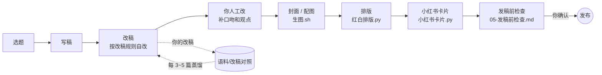
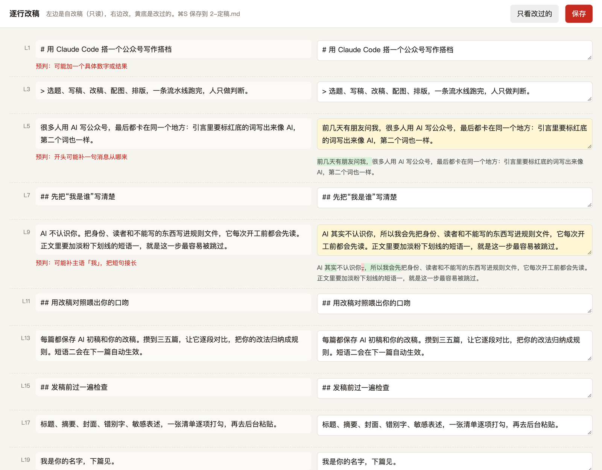

<div align="center">


# 公众号创作 Agent · WeChat Creator Agent

**一个开箱即用的编程 Agent 工作台模板（Claude Code / Codex / Kimi Code / ZCode / Gemini CLI / Cursor 通用）：选题、写稿、改稿、封面配图、排版、小红书卡片、发稿前检查，一条流水线跑完，人只做判断。**

*An agent-agnostic template (AGENTS.md + Agent Skills) that turns one person into a full WeChat Official Account content team.*

[](LICENSE)
[](#-适配不同-agent)
[](#-生图配置)
[](https://github.com/yan9651688/wechat-creator-agent/pulls)

</div>

## ❤️ 赞助商

> 想出现在这里？欢迎通过 [Issue](https://github.com/yan9651688/wechat-creator-agent/issues) 联系我们。

<details open>
<summary>点击折叠</summary>

[](https://www.yituohub.si/)

感谢 **易拓 AI** 赞助本项目！易拓 AI 提供安全、稳定、透明的 GPT、Claude 等 AI 模型 API 服务（OpenAI 兼容），支持 Codex、Claude Code / Claude 桌面版等客户端**一键配置**，按量计费、用多少付多少；站内还提供基于 GPT Image 的文生图与改图。本项目的 `工具/生图.sh` 默认对接的 OpenAI 兼容生图接口即可在易拓 AI 开通：👉 [www.yituohub.si](https://www.yituohub.si/)

</details>

## 🤔 这是什么

用 AI 写公众号，难的从来不是“写出来”，而是：**写得像你**、**排得好看**、**图配得上**、**发之前不出错**。

这个仓库是一个**编程 Agent 工作目录模板**。不管你用 Claude Code、Codex、Kimi Code、ZCode 还是别的 Agent 打开它，`AGENTS.md` 都会告诉 Agent 先读哪些规则、按什么顺序干活、哪些事必须停下来等你确认。你只需要填好“我是谁”、攒几篇改稿对照，剩下的交给流水线。

## ✨ 核心特性

- **换 Agent 不用重抄规则**：规则只写在 `AGENTS.md` 和 `规则/`，技能按开放的 Agent Skills 格式放在 `.agents/skills/`；`一键配置.py` 按你用的 Agent 生成入口文件和技能链接。
- **规则驱动，不靠提示词玄学**：`规则/` 下 6 个文件分别管身份、写稿改稿、形象封面、排版、发稿检查、小红书，Agent 每次开工先读。
- **逐行改稿页**：`逐行改稿.py` 起一个本地对照页，左边自改稿加 AI 的改稿预判，右边直接改，保存成定稿，改完再对照预判沉淀规则。
- **越用越像你的改稿飞轮**：保存 AI 初稿和你的改稿，每 3～5 篇让 Agent 逐段 diff，把你的改法蒸馏成 `改稿规则.md`，下一篇自动生效。
- **保留作者口吻**：`check_prose.py --advisory` 只提供审稿观察，`句子形状.py` 只做描述统计。两者都不替作者改稿，不把长句、短句或某个词当作 AI 判据。
- **红白杂志风排版**：`红白排版.py` 把 Markdown 排成公众号可直接粘贴的富文本，只加样式不改原文；同时内置 `gzh-design` skill 的 6 套主题。
- **一键复制总页**：标题、摘要、正文富文本、两张封面，全部一键复制到公众号后台。
- **小红书卡片不错字**：字由浏览器排、图由模型画，`小红书卡片.py` 输出 1242×1660 竖图。
- **一条命令生图**：`生图.sh` 支持任意 OpenAI 兼容图片接口，也可退回 Codex CLI 的 image_gen；可带上你的 IP 形象参考。
- **人工改稿不跳过**：自改稿写完先停下，附上最需要你补口吻、观点的几处位置，你改完才算定稿。
- **系列图不穿帮**：一组 6 张同一故事的图，衣着从头到脚写死、变了的东西单张说、关键线索写成量得出来的样子，附一段题材模板（54 张实测，见 `规则/03-形象与封面.md`）。
- **画风提示词实测法**：形容词翻成看得见的特征，同场景两轮对比再定稿，可合成一段多画风合集提示词（见 `规则/03-形象与封面.md`）。
- **发送 / 发布 / 付款一律停在你确认之前**：写进硬规矩。

## 🔄 工作流程




## 🖼️ 效果展示

> 以下图片均由本仓库工具对 `文章/2026-01-01-示例文章/` 实际生成。

| 公众号封面（2.35:1） | 红白排版正文 |
|:---:|:---:|
|  |  |

**小红书卡片**（`小红书卡片.py`，1242×1660）


**一键复制总页**（`一键复制总页.py`）


**逐行改稿页**（`逐行改稿.py`）

AI 自改完先停下，左边是 `1-自改稿.md` 和 `改稿对照.md` 里的预判（红字），右边逐段改，改过的段落标黄并标出增删，⌘S 保存到 `2-定稿.md`。改完让 Agent 对照预判看猜中了哪些、哪些没料到，没料到的改法经你确认后沉淀进规则。



## 📁 目录结构

```
.
├── AGENTS.md              # 所有 Agent 共用的入口：读取顺序、流程、硬规矩、各家差异
├── CLAUDE.md              # Claude Code 入口，只有一行 @AGENTS.md
├── 一键配置.md             # 写给 Agent 看的配置步骤
├── 开始使用.md             # 首次配置清单（给人看）
├── requirements.txt
├── 规则/
│   ├── 01-我是谁.md        # 身份、读者、不能写的
│   ├── 02-写稿与改稿.md
│   ├── 03-形象与封面.md
│   ├── 04-公众号排版.md
│   ├── 05-发稿前检查.md
│   └── 06-小红书.md
├── 语料/                   # 改稿对照与范文（默认不入库）
├── 素材/IP/                # 你的形象参考图（默认不入库）
├── 工具/
│   ├── 生图.sh             # OpenAI 兼容接口 / Codex image_gen
│   ├── 生图api.py          # 接口模式：参考图、重试、生图记录
│   ├── 红白排版.py + 红白配置.json
│   ├── 一键复制总页.py
│   ├── 小红书卡片.py
│   ├── 逐行改稿.py         # 左右对照改稿页，保存到 2-定稿.md
│   ├── 一键配置.py         # 环境检查、生成各 Agent 入口和技能链接
│   └── 句子形状.py
├── 文章/                   # 每篇一个目录，含一篇示例
├── docs/images/            # README 配图
├── .agents/skills/         # gzh-design（AGPL-3.0）、human-writing（MIT），Agent Skills 格式
└── .claude/skills          # 指向 .agents/skills 的链接，给 Claude Code 自动发现用
```

## 🚀 快速开始

```bash
git clone https://github.com/yan9651688/wechat-creator-agent.git
cd wechat-creator-agent
claude      # 或 codex / kimi / 你用的任何 Agent
```

然后对 Agent 说一句：

> 读 `一键配置.md`，帮我把这个仓库配好。

它会自己跑 `python3 -I 工具/一键配置.py --agent <它自己>`：检查 Python、Pillow、Chrome、生图通道，生成它需要的入口文件和技能链接，再问你三个问题把 `规则/01-我是谁.md` 填上。不想让 Agent 做，也可以自己跑：

```bash
python3 -m pip install -r requirements.txt
cp .env.example .env                              # 需要生图时再填密钥
python3 -I 工具/一键配置.py --agent claude codex  # 你用哪几个就写哪几个，all 表示全部
```

配置完成后，日常就一句话：

> 写一篇关于「XXX」的公众号，按流程走到发稿前检查。

手动跑工具：

```bash
python3 -I 工具/红白排版.py 工具/红白配置.json 文章/<目录>/1-自改稿.md 文章/<目录>/<名>_排版_红白.html
python3 -I 工具/小红书卡片.py 文章/<目录>/小红书          # 读取 分镜.json
python3 -I 工具/一键复制总页.py 文章 总页.html <目录>...
python3 -I 工具/逐行改稿.py 文章/<目录>                    # 左右对照改稿，保存到 2-定稿.md
工具/生图.sh 文章/<目录>/配图/封面.png "画面描述"
python3 -I 工具/句子形状.py 文章/<目录>/1-自改稿.md --reference 语料/改稿对照/samples/<人工稿>.md
python3 -I .agents/skills/human-writing/scripts/check_prose.py --advisory 文章/<目录>/1-自改稿.md
```

审稿提示不是必须清零的错误。作者已确认的冒号、重复、短句、长句和强判断都可以保留；没有人工语料时，不拿别人的句长或口头禅填空。近期调整与回归检查见 [更新说明](CHANGELOG.md)。

## 🤝 适配不同 Agent

规则只有一份，写在 `AGENTS.md`；技能按 [Agent Skills](https://agentskills.io) 格式放在 `.agents/skills/`。各家读的入口和技能目录不一样，`工具/一键配置.py` 负责补齐：

| Agent | `--agent` | 自动读的入口 | 技能 | 一键配置做什么 |
|---|---|---|---|---|
| Claude Code | `claude` | `CLAUDE.md`，里面 `@AGENTS.md` 导入 | `.claude/skills`（链接到 `.agents/skills`） | 检查 `CLAUDE.md`，补技能链接 |
| Codex CLI | `codex` | `AGENTS.md` | `.agents/skills` | 不用生成文件 |
| Kimi Code | `kimi` | `AGENTS.md` | `.agents/skills` | 不用生成文件 |
| ZCode | `zcode` | `AGENTS.md` | 未核实，按路径读 `SKILL.md` | 不用生成文件 |
| Gemini CLI | `gemini` | `GEMINI.md` | 按路径读 `SKILL.md` | 生成指回 `AGENTS.md` 的 `GEMINI.md` |
| Cursor | `cursor` | `AGENTS.md` | 按路径读 `SKILL.md` | 不用生成文件 |
| 其他 | `other` | 第一句让它读 `AGENTS.md` | 按路径读 `SKILL.md` | 不用生成文件 |

模型能力也不一样：有的不能看图，有的跑在沙箱里不能联网或起本地端口，有的不自带生图，有的上下文短。`AGENTS.md` 最后一节「不同 Agent 怎么用这套东西」按能力写了退路：做不到的就说清楚卡在哪、把命令交给你，不假装做过；要记住的事写进仓库文件，不只存在某一家的记忆里，换 Agent 也接得上。

> 表里 ZCode 的说法来自第三方介绍页，智谱官方文档里没找到入口文件和技能目录的说明；Codex、Kimi Code 依据各自官方文档。这些 Agent 更新很快，以你手上的版本为准，读不到 `AGENTS.md` 的就在第一句话里让它先读。

## 🎨 生图配置

`工具/生图.sh` 有两种模式：

1. **OpenAI 兼容接口**（推荐）：在 `.env` 或环境变量中设置

   | 变量 | 说明 | 默认 |
   |---|---|---|
   | `IMAGE_API_KEY` | 接口密钥（必填才启用此模式） | — |
   | `IMAGE_API_BASE` | 接口地址，含 `/v1` | `https://api.openai.com/v1` |
   | `IMAGE_MODEL` | 模型名 | `gpt-image-1` |
   | `IMAGE_SIZE` | 尺寸，如 `1024x1024` / `1152x864` / `864x1152` | `1024x1024` |

   脚本转给 `工具/生图api.py`：`素材/IP/` 有参考图时调 `POST {IMAGE_API_BASE}/images/edits` 带上参考图，没有时调 `/images/generations`；兼容返回 `url` 或 `b64_json`；接口回「请求较多」之类没给图时等 20 秒重试，最多 8 次。

2. **Codex CLI**：没设置 `IMAGE_API_KEY` 时，自动调用 `codex exec` 的 image_gen（需本机已登录 Codex）。

`NO_IP=1 工具/生图.sh ...` 可忽略 IP 参考，出纯底图（小红书封面、纹理）。

> ⚠️ `.env` 已在 `.gitignore` 中，请勿把密钥提交到仓库。

## 🛠️ 自定义

- **`规则/01-我是谁.md`**：把 `<…>` 换成你的名字、平台、读者、禁区，这是最重要的一步。
- **`语料/`**：放 3～5 篇你最满意的旧文到 `范文/`，每篇新稿把 AI 初稿和你的改稿存到 `改稿对照/samples/`。
- **`素材/IP/`**：放 `身份参考.png`、`风格参考.png`、`头像.jpg`、`角色与画风说明.txt`，生图和小红书角标会自动用上。
- **`工具/红白配置.json`**：每篇一项，配置署名、看点、章节英文小标、要加下划线的短语。
- 小红书卡片署名：环境变量 `XHS_NAME`；浏览器路径：`CHROME`（Linux 会自动找 `google-chrome` / `chromium`）。

## ❓ FAQ

**Q：必须用 Claude Code 吗？**
A：不用。规则在 `AGENTS.md`，Codex、Kimi Code、ZCode、Cursor 原生读它，Claude Code 和 Gemini CLI 通过一行导入读它。见「适配不同 Agent」。

**Q：同时用好几个 Agent 会打架吗？**
A：不会，大家读的是同一份 `AGENTS.md` 和同一批文件。只要别让两个 Agent 同时改同一篇稿子。

**Q：没有生图密钥能用吗？**
A：能。除生图外的写稿、排版、卡片、总页都不依赖任何 API；生图可用 Codex CLI 或手动放图。

**Q：排版复制到公众号会掉格式吗？**
A：样式全部内联、文字用 `<span leaf>` 包裹，并规避渐变等 darkmode 检测项；粘贴前可用 `gzh-design/scripts/validate_gzh_html.py` 校验。

**Q：我的文章和语料会被提交吗？**
A：`.gitignore` 默认忽略 `文章/`、`语料/`、`素材/IP/` 下的个人内容（示例文章除外）。

**Q：小红书卡片字会不会错？**
A：不会，文字由 Chromium 渲染，模型只负责底图。

## 🔗 相关项目

- [yituo-hub-studio](https://github.com/yan9651688/yituo-hub-studio) —— 公众号排版工坊：20 套主题、AI 创作、生图工作台
- [studio.yituohub.com](https://studio.yituohub.com) —— 在线体验，无需安装

## 💬 联系作者 / 交流群

<div align="center">


<sub>扫码加微信，备注「创作 Agent」，拉你进交流群</sub>

</div>

## 📄 许可证

本项目代码与模板以 [MIT](LICENSE) 协议开源。`.agents/skills/` 下的第三方 skill 保留各自许可证：`gzh-design` 为 AGPL-3.0，`human-writing` 为 MIT。
