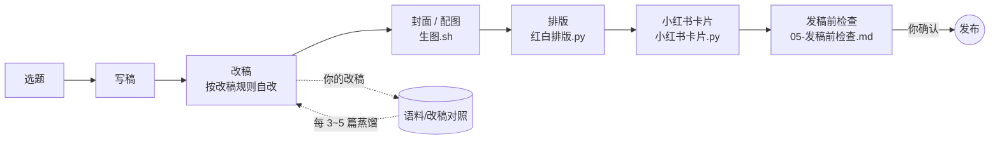
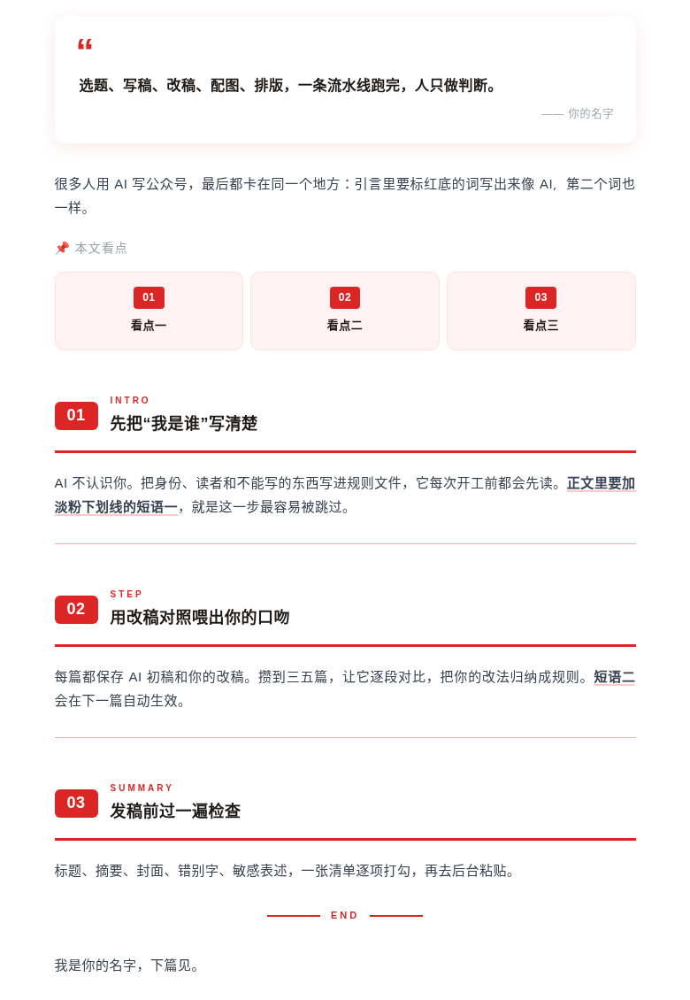
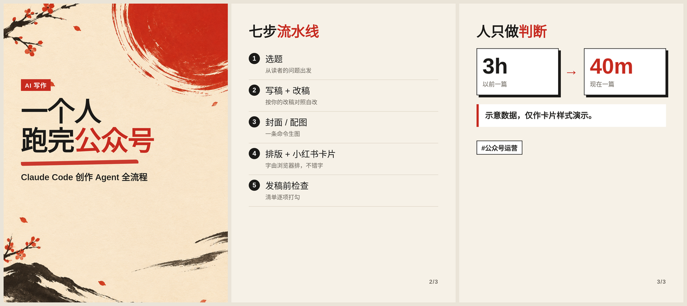
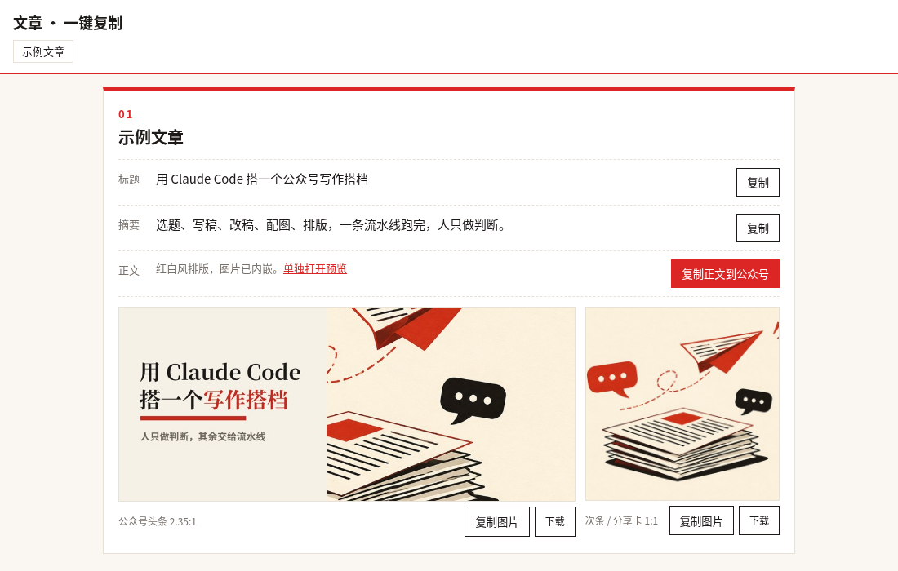

<div align="center">


# 公众号创作 Agent · WeChat Creator Agent

**一个开箱即用的 Claude Code 模板：选题、写稿、改稿、封面配图、排版、小红书卡片、发稿前检查，一条流水线跑完，人只做判断。**

*A Claude Code template that turns one person into a full WeChat Official Account content team.*

[](LICENSE)
[](https://claude.ai/code)
[](#-生图配置)
[](https://github.com/yan9651688/wechat-creator-agent/pulls)

</div>

## ❤️ 赞助商

> 想出现在这里？欢迎通过 [Issue](https://github.com/yan9651688/wechat-creator-agent/issues) 联系我们。

<details open>
<summary>点击折叠</summary>

[](https://www.yituohub.si/)

感谢 **易拓 AI** 赞助本项目！易拓 AI 提供安全、稳定、透明的 GPT、Claude 等 AI 模型 API 服务（OpenAI 兼容），支持 Codex、Claude Code / Claude 桌面版等客户端**一键配置**，按量计费、用多少付多少；站内还提供基于 GPT Image 的文生图与改图。本项目的 `工具/生图.sh` 默认对接的 OpenAI 兼容生图接口即可在易拓 AI 开通：👉 [www.yituohub.si](https://www.yituohub.si/)

</details>

## 🤔 这是什么

用 AI 写公众号，难的从来不是“写出来”，而是：**写得像你**、**排得好看**、**图配得上**、**发之前不出错**。

这个仓库是一个 **Claude Code 工作目录模板**。用 Claude Code 打开它，`CLAUDE.md` 会告诉 Agent 先读哪些规则、按什么顺序干活、哪些事必须停下来等你确认。你只需要填好“我是谁”、攒几篇改稿对照，剩下的交给流水线。

## ✨ 核心特性

- **规则驱动，不靠提示词玄学**：`规则/` 下 6 个文件分别管身份、写稿改稿、形象封面、排版、发稿检查、小红书，Agent 每次开工先读。
- **越用越像你的改稿飞轮**：保存 AI 初稿和你的改稿，每 3～5 篇让 Agent 逐段 diff，把你的改法蒸馏成 `改稿规则.md`，下一篇自动生效。
- **去 AI 腔**：内置 `human-writing` skill + `句子形状.py`，检查句式单调、套话、排比腔。
- **红白杂志风排版**：`红白排版.py` 把 Markdown 排成公众号可直接粘贴的富文本，只加样式不改原文；同时内置 `gzh-design` skill 的 6 套主题。
- **一键复制总页**：标题、摘要、正文富文本、两张封面，全部一键复制到公众号后台。
- **小红书卡片不错字**：字由浏览器排、图由模型画，`小红书卡片.py` 输出 1242×1660 竖图。
- **一条命令生图**：`生图.sh` 支持任意 OpenAI 兼容图片接口，也可退回 Codex CLI 的 image_gen；可带上你的 IP 形象参考。
- **发送 / 发布 / 付款一律停在你确认之前**：写进硬规矩。

## 🔄 工作流程




## 🖼️ 效果展示

> 以下图片均由本仓库工具对 `文章/2026-01-01-示例文章/` 实际生成。

| 公众号封面（2.35:1） | 红白排版正文 |
|:---:|:---:|
|  |  |

**小红书卡片**（`小红书卡片.py`，1242×1660）



**一键复制总页**（`一键复制总页.py`）



## 📁 目录结构

```
.
├── CLAUDE.md              # Agent 入口：读取顺序、流程、硬规矩
├── 开始使用.md             # 首次配置清单
├── 规则/
│   ├── 01-我是谁.md        # 身份、读者、不能写的
│   ├── 02-写稿与改稿.md
│   ├── 03-形象与封面.md
│   ├── 04-公众号排版.md
│   ├── 05-发稿前检查.md
│   └── 06-小红书.md
├── 语料/                   # 改稿对照与范文（默认不入库）
├── 素材/IP/                # 你的形象参考图（默认不入库）
├── 工具/
│   ├── 生图.sh             # OpenAI 兼容接口 / Codex image_gen
│   ├── 红白排版.py + 红白配置.json
│   ├── 一键复制总页.py
│   ├── 小红书卡片.py
│   └── 句子形状.py
├── 文章/                   # 每篇一个目录，含一篇示例
├── docs/images/            # README 配图
└── .claude/skills/         # gzh-design（AGPL-3.0）、human-writing（MIT）
```

## 🚀 快速开始

```bash
git clone https://github.com/yan9651688/wechat-creator-agent.git
cd wechat-creator-agent
cp .env.example .env        # 需要生图时再填
pip install pillow          # 一键复制总页需要
claude                      # 用 Claude Code 打开
```

然后对 Claude 说：

> 读一下 开始使用.md，带我完成首次配置。

配置完成后，日常就一句话：

> 写一篇关于「XXX」的公众号，按流程走到发稿前检查。

手动跑工具：

```bash
python3 -I 工具/红白排版.py 工具/红白配置.json 文章/<目录>/1-自改稿.md 文章/<目录>/<名>_排版_红白.html
python3 -I 工具/小红书卡片.py 文章/<目录>/小红书          # 读取 分镜.json
python3 -I 工具/一键复制总页.py 文章 总页.html <目录>...
工具/生图.sh 文章/<目录>/配图/封面.png "画面描述"
```

## 🎨 生图配置

`工具/生图.sh` 有两种模式：

1. **OpenAI 兼容接口**（推荐）：在 `.env` 或环境变量中设置

   | 变量 | 说明 | 默认 |
   |---|---|---|
   | `IMAGE_API_KEY` | 接口密钥（必填才启用此模式） | — |
   | `IMAGE_API_BASE` | 接口地址，含 `/v1` | `https://api.openai.com/v1` |
   | `IMAGE_MODEL` | 模型名 | `gpt-image-1` |
   | `IMAGE_SIZE` | 尺寸，如 `1024x1024` / `1152x864` / `864x1152` | `1024x1024` |

   脚本调用 `POST {IMAGE_API_BASE}/images/generations`，兼容返回 `url` 或 `b64_json`。

2. **Codex CLI**：没设置 `IMAGE_API_KEY` 时，自动调用 `codex exec` 的 image_gen（需本机已登录 Codex）。

`NO_IP=1 工具/生图.sh ...` 可忽略 IP 参考，出纯底图（小红书封面、纹理）。

> ⚠️ `.env` 已在 `.gitignore` 中，请勿把密钥提交到仓库。

## 🛠️ 自定义

- **`规则/01-我是谁.md`**：把 `<…>` 换成你的名字、平台、读者、禁区，这是最重要的一步。
- **`语料/`**：放 3～5 篇你最满意的旧文到 `范文/`，每篇新稿把 AI 初稿和你的改稿存到 `改稿对照/samples/`。
- **`素材/IP/`**：放 `身份参考.png`、`风格参考.png`、`头像.jpg`、`角色与画风说明.txt`，生图和小红书角标会自动用上。
- **`工具/红白配置.json`**：每篇一项，配置署名、看点、章节英文小标、要加下划线的短语。
- 小红书卡片署名：环境变量 `XHS_NAME`；浏览器路径：`CHROME`（Linux 会自动找 `google-chrome` / `chromium`）。

## ❓ FAQ

**Q：必须用 Claude Code 吗？**
A：规则和工具都是普通文件，Codex、Cursor 等能读 `CLAUDE.md` 的 Agent 也能用，Claude Code 体验最好。

**Q：没有生图密钥能用吗？**
A：能。除生图外的写稿、排版、卡片、总页都不依赖任何 API；生图可用 Codex CLI 或手动放图。

**Q：排版复制到公众号会掉格式吗？**
A：样式全部内联、文字用 `<span leaf>` 包裹，并规避渐变等 darkmode 检测项；粘贴前可用 `gzh-design/scripts/validate_gzh_html.py` 校验。

**Q：我的文章和语料会被提交吗？**
A：`.gitignore` 默认忽略 `文章/`、`语料/`、`素材/IP/` 下的个人内容（示例文章除外）。

**Q：小红书卡片字会不会错？**
A：不会，文字由 Chromium 渲染，模型只负责底图。

## 🔗 相关项目

- [yituo-hub-studio](https://github.com/yan9651688/yituo-hub-studio) —— 公众号排版工坊：20 套主题、AI 创作、生图工作台
- [studio.yituohub.com](https://studio.yituohub.com) —— 在线体验，无需安装
- [gzh-design-skill](https://github.com/isjiamu/gzh-design-skill) —— 本仓库内置的排版 skill

## 📄 许可证

本项目代码与模板以 [MIT](LICENSE) 协议开源。`.claude/skills/` 下的第三方 skill 保留各自许可证：`gzh-design` 为 AGPL-3.0，`human-writing` 为 MIT。
